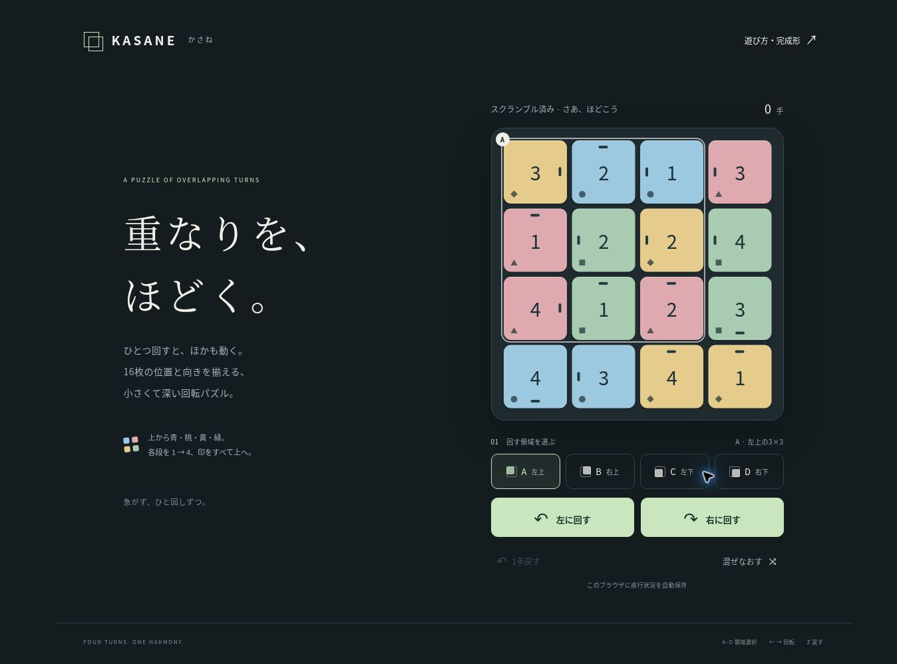

# KASANE — かさね

重なる領域を回して、16枚の位置と向きを揃える回転パズル。
フレームワーク・外部フォント・CDN・サーバーへの通信に依存しない静的サイトです。



## 遊び方

初回アクセス時に48手の合法手で自動スクランブルします。
4×4盤面に重なる4つの3×3領域を、A（左上）、B（右上）、C（左下）、D（右下）から選びます。
左右の回転ボタンで、選んだ9枚を90度回します。中央の1枚も印の向きが変わります。

完成形は上から青・桃・黄・緑の4行。各行の番号は左から1・2・3・4、すべての印は上向きです。
色と番号が揃っても、印の向きが違えば未完成です。色は丸・三角・ひし形・四角でも区別できます。

- `A`〜`D`：領域を選択
- `←` / `→`：90度回転
- `Z`：プレイヤーの操作を1手戻す（スクランブルは戻しません）
- 「遊び方・完成形」：完成形を表示
- 「混ぜなおす」：新しい問題に変更。途中なら確認を表示

進行状況は同じブラウザのlocalStorageに保存されます。再読み込みで続きから再開します。
端末間同期・アカウント・ランキング・広告・解析・自動解答はありません。
保存が許可されない環境でも、そのページを開いている間は遊べます。

## GitHub Pages

想定URL：**https://megaminxkr.github.io/new_puzzle/**

このURLはPagesを有効化し、デプロイが成功した後に利用できます。
この実装の保存時点ではリポジトリは非公開、Pagesは未設定でした。

1. リポジトリの **Settings → Pages** を開きます。
2. **Build and deployment → Source → Deploy from a branch** を選択します。
3. **Branch: main / Folder: /(root)** を選び、**Save** を押します。
4. Pages画面でデプロイ完了と公開URLを確認します。

非公開リポジトリでPagesを使えないプランの場合は、リポジトリをPublicにする必要があります。
公開範囲の変更は利用者自身で判断してください。ビルドコマンドやnpm installは不要です。
`.nojekyll`を同梱し、すべてのアセットを相対パスで参照するため、`/new_puzzle/`の配下で動きます。

## 群の構造と設計

状態は16枚の置換と、各ピースの4方向の向きで表現します。
4つの時計回り操作を `A, B, C, D` とすると、操作群は `G = <A, B, C, D>` です。

- 各生成元は位数4。逆回転は時計回り3回と等しい。
- 重なる領域の回転は一般に非可換。例えば `AB != BA`。
- 3×3回転は位置のチェッカーボード色を保存するため、任意の16枚の交換はできません。
- 外周の2つの4-cycleの積として位置を動かし、9枚それぞれの向きを1増やします。
- スクランブルを合法手のみから作るので、逆手順で必ず完成形へ戻せます。
- スクランブルは直前と同じ領域を避けた48手のランダムウォークです。全状態からの一様抽出、最短距離、難易度保証を意味しません。

各ピースに4つの方向マーカーを考えた64点上の忠実な置換表現について、SymPyの置換群計算で得られる位数は

**1,745,584,660,257,177,600 ≈ 1.75 × 10^18**

です。計算は `scripts/verify_group.py` で再現できます。
これは到達可能な状態数であり、人間にとっての難しさを直接測る値ではありません。
3×3×3ルービックキューブ程度の攻略性を目標にしていますが、同等の体感難易度を保証するプレイテストはまだ行っていません。
操作の非可換性、共役、交換子を使って「ある部分を元に戻しつつ、別の部分だけを変える」手順を探索する設計です。

## 開発と検証

Node.js 20以降で、追加依存なしに実行できます。

```sh
npm test
node --check app.js
```

任意の静的HTTPサーバーでルートを配信します。例：

```sh
python -m http.server 8000
```

`http://localhost:8000/`で開いてください。ES Modulesを使うので `file://` の直接オープンは対象外です。
群の位数の独立検証のみ、PythonとSymPyが必要です。

```sh
python -m pip install sympy
python scripts/verify_group.py
```

検証の内容・実施範囲は [TESTING.md](TESTING.md) に記載しています。
GitHub Actionsはpush/PR時にロジックテストとJavaScriptの構文検査を実行します。

| ファイル | 内容 |
| --- | --- |
| `engine.js` | DOMに依存しない回転・スクランブル・復元処理 |
| `app.js` | 描画・アニメーション・操作・自動保存 |
| `index.html`, `style.css` | 画面・完成形ガイド・レスポンシブ表示 |
| `tests/engine.test.js` | 決定的なシードによる回帰テスト |
| `scripts/verify_group.py` | 64点置換表現による群の位数計算 |

モダンブラウザを対象とします。外部サービスへのデータ送信はありません。
